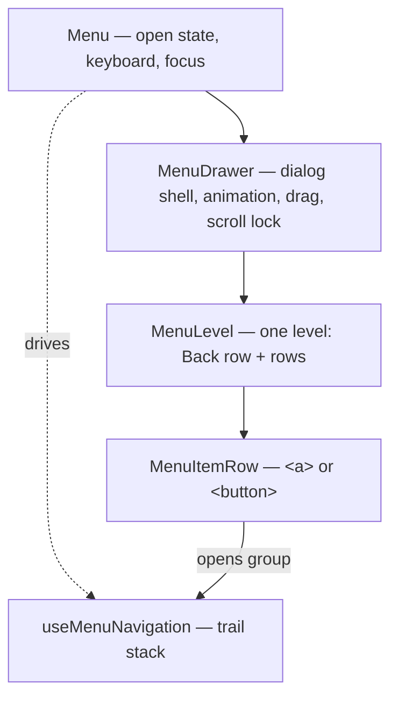
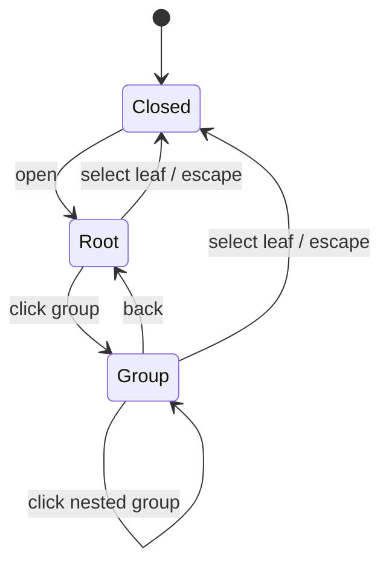

# Menu

A nested navigation menu for React: a bottom sheet on mobile, a right-side drawer on desktop (`lg:` and up). Any depth of submenus, keyboard navigation, drag-to-dismiss, direction-aware animations.

## Usage

```tsx
import { Menu, type MenuItem } from './components/Menu'
import { House, Package } from 'lucide-react'

const items: MenuItem[] = [
  { id: 'home', label: 'Home', icon: House, href: '#home' },
  {
    id: 'products',
    label: 'Products',
    icon: Package,
    children: [
      { id: 'web-apps', label: 'Web Apps', icon: Globe, href: '#web-apps' },
      { id: 'storage', label: 'Storage', icon: Database, disabled: true },
    ],
  },
]

function App() {
  return (
    <Menu
      items={items}
      label="Main menu"
      onSelect={(item, trail) => console.log(trail.map((g) => g.label), item.label)}
    />
  )
}
```

`onSelect` fires on a leaf item, with the `trail` of groups leading to it. The drawer closes after selection unless `closeOnSelect={false}`.

## Architecture



Only `Menu` and its types (`MenuItem`, `MenuIcon`, `isGroup`) are exported; everything else is internal.

## How it's used



## Props

| Prop | Type | Default | Description |
|---|---|---|---|
| `items` | `MenuItem[]` | — | The menu tree. Any depth. |
| `label` | `string` | `'Main menu'` | Accessible name for the drawer. |
| `triggerLabel` | `string` | `'Open Menu'` | Text of the trigger button. |
| `onSelect` | `(item, trail) => void` | — | Called when a leaf item is chosen. |
| `closeOnSelect` | `boolean` | `true` | Close the drawer after selecting a leaf. |
| `dragToDismiss` | `boolean` | `true` | Drag the sheet down to close (mobile). |

### `MenuItem`

```ts
interface MenuItem {
  id: string            // unique across the whole tree — drives navigation, focus-restore, and selection
  label: string          // display text only — duplicates across items are fine
  description?: string
  icon: MenuIcon
  href?: string
  disabled?: boolean
  children?: MenuItem[] // makes this a group
}
```

## Behavior

- Closing the drawer doesn't reset its position — reopening it resumes at whatever level (and selection) you were on, instead of jumping back to the root. This is deliberate, not a bug.

## Accessibility

- Native `<dialog>` + `showModal()`: focus trap, inert background, Escape-to-close.
- Arrow Up/Down move focus, Home/End jump, Arrow Right opens a group, Arrow Left goes back.
- Going back refocuses the row you drilled in from.
- A live region announces each level change for screen readers.

## Development

```
npm run dev     # start the dev server
npm run build   # type-check and build
npm run lint    # eslint
npm test        # vitest
```
